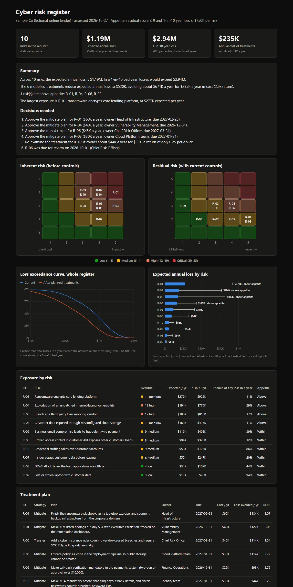

# cyber-risk-register

[](https://github.com/Uppula4070/cyber-risk-register/actions/workflows/ci.yml)

A cyber risk register as code. Each risk is a short YAML entry. `riskreg` validates the register and produces a board-ready report. The report:
- scores every risk on a **5×5 likelihood × impact** matrix, before and after controls
- maps controls to **NIST CSF 2.0** and **ISO/IEC 27001:2022 Annex A**, and checks the control IDs
- runs a **FAIR-style Monte Carlo simulation** to turn estimates into dollars: expected annual loss, the 1-in-10 bad year, and a loss exceedance curve
- calculates **return on security investment (ROSI)** for each planned treatment
- flags risks above the organization's **risk appetite** and writes the **decisions leadership needs to make**



**→ Download the [sample report](docs/sample-report.html)** and open it in a browser, or read the [board summary](docs/sample-summary.md).

## Example

```
$ riskreg examples/sample-co/risks.yaml --summary summary.md
Across 10 risks, the expected annual loss is $1.19M. In a 1-in-10 bad year, losses would exceed $2.94M.
The 6 modelled treatments reduce expected annual loss to $520K, avoiding about $671K a year for $235K a year in cost (2.9x return).
4 risk(s) are above appetite: R-01, R-04, R-06, R-03.
The largest exposure is R-01, ransomware encrypts core lending platform, at $277K expected per year.
```

The report then lists the **decisions needed**, for example:
- *"Approve the mitigate plan for R-04 ($40K a year, owner Vulnerability Management, due 2026-12-31)."*
- *"Re-examine the treatment for R-10: it avoids about $44K a year for $35K, a return of only 0.25 per dollar."*
- *"R-06 was due for review on 2026-10-01."*

## Writing a risk

```yaml
- id: R-04
  title: Exploitation of an unpatched internet-facing vulnerability
  category: Vulnerability management
  owner: CISO
  inherent: {likelihood: 4, impact: 4}      # before controls
  residual: {likelihood: 3, impact: 4}      # with controls as they operate today
  controls:
    - name: Weekly external scanning with SLA-tracked remediation
      status: implemented                    # implemented | partial | planned
      nist_csf: [ID.RA-01, PR.PS-02]
      iso27001: [A.8.8]
  fair:                                      # [min, most likely, max]
    frequency: [0.1, 0.3, 0.8]               # loss events per year
    magnitude: [50000, 300000, 2000000]      # loss per event
  treatment:
    strategy: mitigate                       # mitigate | accept | transfer | avoid
    plan: Make KEV-listed findings a 7-day SLA with executive escalation.
    owner: Vulnerability Management
    due: 2026-12-31
    cost: 40000                              # per year
    after:                                   # estimate once the treatment is in place
      frequency: [0.05, 0.15, 0.4]
      magnitude: [50000, 250000, 1500000]
  review_date: 2026-11-30
```

The register also sets the **risk appetite**: a maximum residual score, and optionally a maximum 1-in-10 year loss per risk.

## How the numbers are produced

**Qualitative:** likelihood (1–5) × impact (1–5). Low 1–5, medium 6–11, high 12–19, critical 20–25.

**Quantitative (FAIR-style Monte Carlo):** for each of 10,000 simulated years, and for each risk:
1. Draw an event rate from a **PERT distribution** of the min / most likely / max frequency.
2. Draw how many loss events happen that year from a **Poisson distribution** with that rate.
3. Draw a loss for each event from a PERT distribution of the magnitude.

Risks are added **year by year** to get the portfolio. Adding each risk's 90th percentile together would overstate the bad year, because one company rarely has every bad thing happen in the same year.

**ROSI** = (expected annual loss avoided − annual cost) ÷ annual cost. Above 0 means the treatment pays for itself.

The simulation is seeded, so results are reproducible. CI rebuilds the sample report and fails if it changes.

## Validation catches register mistakes

```
$ riskreg risks.yaml --validate
The register has problems to fix:
  - R-01.inherent.likelihood must be a whole number from 1 to 5
  - R-09: residual score is higher than inherent; controls cannot increase risk
  - R-01.controls[1]: 'PR.AC-1' is not a NIST CSF 2.0 subcategory ID like PR.AA-03
  - R-01.controls[1]: 'A.5.38' is not an ISO/IEC 27001:2022 Annex A control (A.5.1 to A.8.34)
  - R-03.fair.frequency must satisfy 0 <= min <= most likely <= max
```

The ISO check knows the 2022 Annex A structure: 93 controls in four themes (5.1–5.37 organizational, 6.1–6.8 people, 7.1–7.14 physical, 8.1–8.34 technological). This catches references copied from the old 2013 numbering. CSF IDs are checked against the 2.0 format, including the new **Govern** function. Old CSF 1.1 IDs like `PR.AC-1` are rejected.

## Usage

```bash
pip install git+https://github.com/Uppula4070/cyber-risk-register.git

riskreg risks.yaml --validate
riskreg risks.yaml -o report.html --summary board-summary.md --json results.json
riskreg risks.yaml --years 50000 --seed 1      # more simulated years, different seed
```

## Engineering notes

- **The simulation is tested against known answers:** the PERT mean, the Poisson mean, frequency × magnitude, and the exceedance curve. Seeds are checked to reproduce identical results.
- **YAML is read with `safe_load`**, and all register text is HTML-escaped. A test puts a `<script>` tag in a risk title.
- **Self-contained report.** Inline SVG charts with hover tooltips, heat maps that list the risk IDs (so color is never the only cue), table views, and light and dark mode. No JavaScript.
- **41 tests** on Python 3.10–3.13, plus ruff with Bandit security rules. The non-cryptographic PRNG is a documented, deliberate exception for Monte Carlo.

## About the sample register

`examples/sample-co/risks.yaml` describes a **fictional** online lender. The risks are typical for the industry, but every estimate is illustrative: chosen to show how the tool works, not taken from benchmarks or any real company. The control IDs are real NIST CSF 2.0 and ISO 27001:2022 references.
